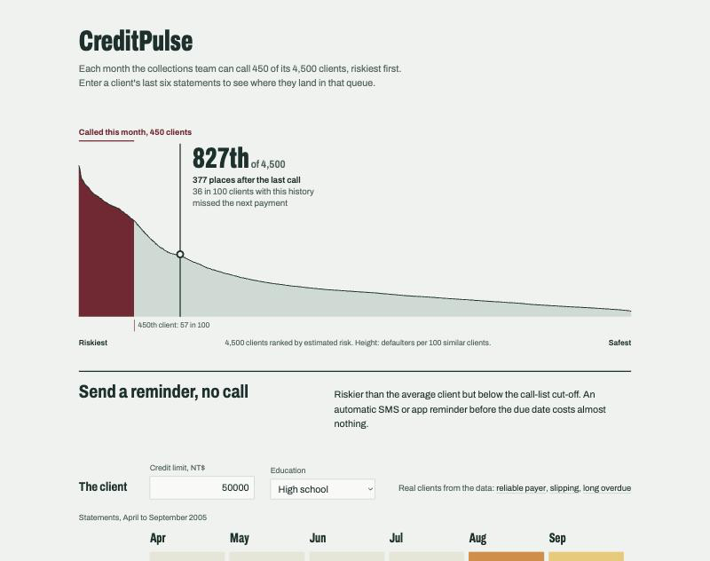

# CreditPulse — Predicting credit-card default one month ahead

**FI510E Artificial Intelligence & Business Applications · Midterm 1 group project · Rabat Business School**

Team: Lucas Clodic, Elisa Ouillet, Iulia Kozhina

A credit-card issuer has a small collections team that can contact about **10% of its clients each month**.
This project trains and compares five machine-learning models that rank clients by their risk of missing next
month's payment, selects the best one on a validation set, tests it once, and serves it through a simple website
where an analyst types in a client's last six statements and sees where the client lands in the monthly call queue.



## Results at a glance

| | Value (held-out test set, 4,500 clients) |
|---|---|
| Selected model | **Random Forest** (chosen on validation Average Precision, near-tie rule below) |
| ROC-AUC | 0.78 |
| Defaulters found in the top 450 contacts | **317 of 450 (70% hit rate)** vs ~99 with random calls |
| Expected net value of the 450 contacts* | ≈ 1.8 M NT$ per 4,500 clients |
| Accuracy at threshold 0.50 | 81.7% (the "predict nobody defaults" baseline is 77.9%) |

\* under stated assumptions: 500 NT$ per contact, +1,500 NT$ goodwill cost per unnecessary contact,
10% of the outstanding bill saved when a future defaulter is contacted early.

### Validation comparison (4,500 clients, threshold 0.50 and top-450 policy)

| Model | Accuracy | Precision | Recall | F1 | Avg. Precision | ROC-AUC | Defaulters in top 450 |
|---|---|---|---|---|---|---|---|
| Baseline: nobody defaults | 0.779 | 0.000 | 0.000 | 0.000 | 0.221 | 0.500 | ~99 (random calls) |
| Logistic Regression | 0.811 | 0.659 | 0.304 | 0.416 | 0.512 | 0.755 | 298 |
| Decision Tree | 0.813 | 0.636 | 0.358 | 0.458 | 0.512 | 0.764 | 307 |
| **Random Forest** | 0.814 | 0.648 | 0.348 | 0.453 | **0.552** | 0.777 | **310** |
| Support Vector Machine | 0.814 | 0.662 | 0.321 | 0.432 | 0.497 | 0.715 | 304 |
| Extreme Gradient Boosting | 0.817 | 0.660 | 0.356 | 0.462 | 0.550 | 0.779 | 310 |

The baseline is right 78% of the time but catches no defaulter, so accuracy alone is misleading here.
Confusion matrices for every model are in the notebook (Task 3).

Random Forest and XGBoost are practically tied. The selection rule, fixed before looking at the test set, is:
highest validation Average Precision; if several models are within **0.005 AP**, keep the one whose result does
not depend on the computer. We added the second part after noticing that the same code, with the same library
versions (scikit-learn 1.8.0, XGBoost 3.4.1), gives XGBoost an AP of 0.554 on one team laptop and 0.550 on
another, while Random Forest stays at 0.552. A 0.004 gap is therefore noise, and a bank does not want its
contact list to change because the model was retrained on another server. The rule picks **Random Forest**
on every machine; XGBoost is an equivalent alternative.

## What we added beyond a standard notebook

1. **Feature engineering** — credit utilisation, repayment ratio, months late, maximum delay, bill trend,
   months without payment. Raises Logistic Regression ROC-AUC from 0.713 to 0.755.
2. **Fairness experiment** — the production model does not use sex, marital status or age. Removing them
   costs at most 0.002 ROC-AUC, and the contact list mirrors the defaulters' composition by sex.
3. **Cost–benefit and capacity analysis** — converts errors into NT$ (false negative = loss not avoided,
   false positive = contact + goodwill cost). Random contacts destroy value; the model's ranking creates
   value up to ~650 contacts, so the 450-contact limit is binding → business case for SMS/app reminders.
   **Sensitivity check:** a missed defaulter costs ~4,700 NT$ vs 2,000 NT$ for a useless call; the 450 calls
   break even as soon as a call saves 2.3% of a defaulter's bill (we assume 10%), and the model's top 450 stays
   profitable in all nine cost scenarios tested (+0.30 to +3.49 M NT$) while random calls lose money in six.
4. **Robustness checks** — 5-fold cross-validation on train + validation: Random Forest (AP 0.562 ± 0.015) and
   XGBoost (0.563 ± 0.013) stay tied, both clearly ahead of the simpler models. Class weighting raises recall at
   0.50 (0.35 → 0.61) but does not improve the ranking (310 → 308 defaulters in the top 450), so it is not used.
5. **Decision-ready website** — places a client in the ranked queue of 4,500 validation clients ("827th of
   4,500, 377 places after the last call"), with the decision, the default rate of similar clients and
   plain-language reasons. The history is edited month by month and the position updates live.

## Repository structure

```
Midterm1_AI_Applications/
├── app/                      # Flask website
│   ├── app.py                # API: POST /api/predict, GET /api/portfolio, GET /api/model
│   ├── templates/index.html
│   └── static/  style.css  app.js
├── data/                     # original UCI .xls + README (source, licence, codebook)
├── models/
│   ├── credit_default_model.joblib   # trained pipeline (features + scaler + model)
│   ├── model_card.json              # metrics, thresholds, assumptions
│   └── portfolio_scores.json        # validation scores, riskiest first (the website's queue)
├── notebooks/credit_default_analysis.ipynb   # executed notebook: full analysis incl. robustness checks
├── reports/
│   ├── business_report.html  # 2–3 page business report (print to PDF from the browser)
│   ├── figures/              # charts used in the presentation
│   ├── *.csv                 # all result tables
│   └── Credit_Review_Top450.csv     # test-period contact list (IDs + scores, no outcome)
├── src/
│   ├── features.py           # cleaning + feature engineering, shared by training and website
│   └── train.py              # full analysis, Tasks 1–7 as in the Session 6 lab
├── requirements.txt
├── Procfile / render.yaml    # one-click deployment
└── README.md
```

## How to run

```bash
git clone https://github.com/juliakozhina2966-cpu/Midterm1_AI_Applications.git
cd Midterm1_AI_Applications
pip install -r requirements.txt

python src/train.py   # retrains the 5 models, writes models/ and reports/
python app/app.py     # starts the website
```

The trained model is already in `models/`, so the website works without retraining.
Open http://127.0.0.1:5000. On macOS, port 5000 is often taken by AirPlay Receiver; in that case run
`flask --app app/app.py run --port 5050` and open http://127.0.0.1:5050.

**Jupyter:** open `notebooks/credit_default_analysis.ipynb` and run all cells; it finds `data/` by itself.

**Google Colab:** clone the repository, then run
`%cd Midterm1_AI_Applications`, `!pip install -r requirements.txt` and `!python src/train.py`,
or open `notebooks/credit_default_analysis.ipynb`.

## Put the website online (free)

1. Push this folder to a GitHub repository.
2. On [render.com](https://render.com) choose **New → Blueprint**, select the repository. `render.yaml`
   configures everything (build `pip install -r requirements.txt`, start `gunicorn app.app:app`).
3. After the build you get a public link such as `https://creditpulse.onrender.com`.

The free plan sleeps after inactivity; open the link a minute before the presentation.

## Method in short

- **Positive class:** default on the October 2005 payment (22.1% of clients).
- **Split:** stratified 70 / 15 / 15 (21,000 train · 4,500 validation · 4,500 test). The dataset has no
  timestamp per row (all clients observed at the same date), so a chronological split is not possible.
- **Preprocessing** (fitted on training data only, inside a scikit-learn `Pipeline`): code cleaning,
  feature engineering, standard scaling, one-hot encoding.
- **Models:** Logistic Regression, Decision Tree, Random Forest, SVM (RBF kernel), XGBoost.
- **Selection:** validation Average Precision (near-ties within 0.005 → the model that is stable across
  computers); Precision/Recall at 450 for the operational view. Same rule in the notebook and in `src/train.py`.
- **Test set:** used once, after the model and policy were frozen.

## Limitations

The data come from one Taiwanese bank in 2005; behaviour, currency and regulation differ today and in Morocco.
The cost figures are assumptions. Predicting default does not prove that a phone call prevents it — that needs a
randomised experiment (contact half of the high-risk clients, compare default rates). Teaching project only, not
a credit decision tool.

## Data

UCI Machine Learning Repository — *Default of Credit Card Clients* (Yeh & Lien, 2009), CC BY 4.0.
See [`data/README.md`](data/README.md).
